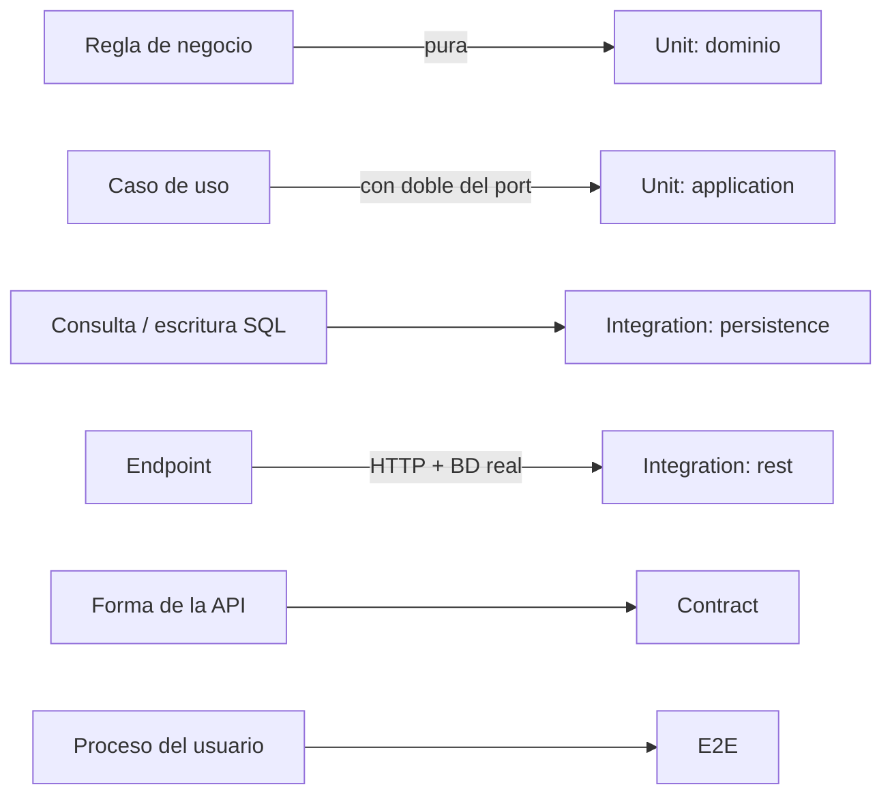

# Plan de pruebas — backend

| Campo | Valor |
|-------|-------|
| Sistema | Plataforma de gestión y optimización de un robot seguidor de línea velocista (APAEC Lab) |
| Componente | `velocista-backend` |
| Responsable de pruebas | Tatiana Priscila Espejo Loyaga |
| Última actualización | 16 oct 2026 |

## 1. Objetivo y alcance

Verificar que el backend cumple las funciones acordadas: catálogo e inventario, armador de robots y
versiones, setups de controladores, historial de corridas (simuladas, de robot e ingestadas desde el
simulador), reglamento, modo/línea, eventos, autenticación y comunicación en tiempo real con robot y cronómetro.

**Dentro del alcance:** API REST (`/api/*`), WebSocket (`/ws/robot`, `/ws/timer`, `/ws/console`), reglas de dominio, persistencia en PostgreSQL.

**Fuera del alcance:** firmware del robot, servicio de simulación (repositorio aparte; solo se prueba su *contrato de ingesta*), rendimiento/carga.

## 2. Estrategia por nivel

| Enfoque | Dónde se aplica |
|---------|-----------------|
| Caja blanca | `unit/*` (se conoce la lógica: rangos, fórmulas, ramas) |
| Caja negra | `integration/rest`, `contract`, `e2e` (solo entradas y salidas HTTP/WS) |
| Funcional | Todo caso que valida una regla del enunciado (J, idempotencia, versiones, etc.) |
| Regresión | Las pruebas de `contract` fallan si se rompe un endpoint, un `operationId` o un campo |

## 3. Entorno

| Elemento | Valor |
|----------|-------|
| Lenguaje | Python 3.12+ |
| Framework de pruebas | pytest 9, pytest-asyncio (`asyncio_mode=auto`), httpx / Starlette `TestClient` |
| Base de datos | PostgreSQL 16 (Docker, puerto 15432 por defecto) |
| Variables | `POSTGRES_*` o `DATABASE_URL`; `SIMULATION_SERVICE_TOKEN` lo fija cada prueba |
| Comando | `pytest` desde la raíz del repositorio |

## 4. Criterios

**Entrada:** rama actualizada, BD levantada, migraciones aplicadas si se usa la BD de desarrollo (las pruebas usan su propio esquema).
**Salida (listo para integrar):** `pytest` en verde (salvo hallazgos documentados), `ruff check` sin errores, ninguna prueba nueva omitida sin motivo.

## 5. Matriz de trazabilidad

Leyenda: **U** unitaria · **P** persistencia · **R** REST · **C** contrato · **E** e2e.

### 5.1 Catálogo e inventario

| Funcionalidad | Endpoint | Tipo | Archivo | Casos clave |
|---------------|----------|:----:|---------|-------------|
| Tipos de componente y ranuras | `GET /component-types`, `/slots` | R | `integration/rest/catalog/test_components_api.py` | lista sembrada, campos |
| Registrar componente (HU-02) | `POST /components` | R | ídem | 201; precio ≤ 0, masa < 0, tipo inexistente → 422 |
| Consultar / editar / archivar | `GET/PATCH/DELETE /components/{id}` | R | ídem | 404 con `reason`, edición parcial, archivado oculto |
| Listado paginado | `GET /components` | R | ídem | `limit`/`offset`, límites inválidos → 422 |
| Inventario del club | `GET /inventory` | R | ídem | disponible = stock − en robots; uso en versión |
| Stock con control de concurrencia | `PUT /inventory/{id}` | R | ídem | `revision` correcta → 200; vieja → 409; stock < 0 → 422 |

### 5.2 Armador de robots y versiones

| Funcionalidad | Endpoint | Tipo | Archivo | Casos clave |
|---------------|----------|:----:|---------|-------------|
| Crear / editar / archivar robot (HU-06) | `/robots` | R | `integration/rest/builder/test_robots_api.py` | `short_code` duplicado → 409; payload inválido; archivado no editable |
| Unicidad de `short_code` | BD | P | `integration/persistence/test_repositories_postgres.py` | restricción única a nivel BD |
| Versión inmutable con *snapshot* | `POST /robots/{id}/versions` | R | `integration/rest/builder/test_versions_api.py` | editar componente no altera versiones previas |
| Concurrencia optimista | ídem | R | ídem | `base_version_id` viejo → 409 `version_stale` |
| Ranuras obligatorias | ídem | R | ídem | versión *current* sin piezas → 422 `required_slots_missing`; *draft* permitido |
| Versión actual / anterior | ídem | R | ídem | la nueva *current* degrada a *previous* |
| Aislamiento entre robots | `GET .../versions/{id}` | R | ídem | versión de otro robot → 404 |
| Nombres en inglés (rechazo de payload legado) | ídem | R | ídem | `version_base_id` → 422 |

### 5.3 Optimización: controladores y setups

| Funcionalidad | Endpoint | Tipo | Archivo | Casos clave |
|---------------|----------|:----:|---------|-------------|
| Validar parámetros contra el catálogo | dominio | U | `unit/domain/optimization/test_validate_parameters.py` | bordes incluidos, fuera de rango, claves distintas, NaN/inf/bool |
| Casos de uso de setups | aplicación | U | `unit/application/optimization/test_optimization_service.py` | versión de otro robot, controlador inexistente, archivar |
| Catálogo de controladores | `GET /controllers` | R | `integration/rest/optimization/test_setups_api.py` | parámetros y *presets* |
| Crear / listar / archivar setup | `/robots/{id}/setups`, `/setups/{id}` | R | ídem | floats, filtros por versión, 404, archivado visible solo por id |
| Aplicar setup / preset al robot | `.../apply`, `/presets/apply` | R | ídem | sin manifiesto → 409; archivado → 409; preset desconocido → 422 |
| Configuración en vivo | `GET .../configuration`, `.../controllers` | R | ídem | sin manifiesto → 404 / ninguno activo |

### 5.4 Corridas (historial y simulación)

| Funcionalidad | Endpoint | Tipo | Archivo | Casos clave |
|---------------|----------|:----:|---------|-------------|
| Métrica J y mejor vuelta | dominio | U | `unit/domain/runs/test_scoring.py` *(existente)* | fórmula `t + 2·error`, 120 si no terminó |
| Corrida simulada | `POST /runs/simulated` | R | `integration/rest/runs/test_runs_api.py` | 201; robot sin versión → 409; J coherente; sectores suman la duración |
| Historial y filtros | `GET /runs` | R | ídem | por robot, controlador, `source`; paginación inválida → 422 |
| Detalle y vueltas | `GET /runs/{id}`, `/laps` | R | ídem | 404, 4 segmentos por vuelta |
| Notas | `PATCH /runs/{id}` | R | ídem | persiste; > 1000 caracteres → 422 |
| Trazabilidad del contexto | — | R | ídem | los parámetros de la corrida sobreviven al archivar el setup |
| **Ingesta desde el simulador** | `POST /runs/ingest` | R | ídem | sin token 401; token malo 401; no configurado 503; 201; **idempotente** (200 + `Idempotent-Replay`); mismo id con otros datos → 409; referencias inexistentes → 404; robot archivado → 409; campos obligatorios → 422 |
| Persistencia de corridas | BD | P | `integration/persistence/test_repositories_postgres.py` | corridas cerradas, simulación sin versión |

### 5.5 Reglas, configuración, eventos, dispositivos, sistema

| Funcionalidad | Endpoint | Tipo | Archivo | Casos clave |
|---------------|----------|:----:|---------|-------------|
| Perfiles de reglamento (HU-10) | `/profiles` | R | `integration/rest/rules/test_profiles_api.py` | lista, detalle, 404 |
| Modo y línea (HU-18) | `/robots/{id}/mode-line*` | R | `integration/rest/config/test_mode_line_api.py` | sin config → 404; sin manifiesto → 409; valores inválidos → 422 |
| Valores permitidos | dominio | U | `unit/domain/config/test_mode_and_line.py` | `test/competition`, `black/white` |
| Bitácora de eventos | `/events` | R | `integration/rest/events/test_events_api.py` | alta, nivel por defecto, validaciones, límite |
| Niveles de evento | dominio | U | `unit/domain/events/test_event_level.py` | `info/warning/error` |
| Dispositivos | `/devices/*` | R | `integration/rest/devices/test_devices_api.py` | sin manifiesto, comando fuera de contrato, dispositivo desconocido |
| Salud y Swagger | `/health`, `/docs` | R | `integration/rest/system/test_health_api.py` | 200, OpenAPI 3.x |
| Autenticación | `/auth/*` + middleware | R | `integration/rest/auth/test_auth_api.py` + `integration/test_authentication.py` *(existente)* | sin token 401, login, `me`, token alterado, `health` público |

### 5.6 Tiempo real (WebSocket)

| Funcionalidad | Tipo | Archivo | Casos clave |
|---------------|:----:|---------|-------------|
| Sesión robot ↔ consola completa | E | `e2e/flows/test_robot_websocket_flow.py` | token malo (1008), manifiesto, estado, comando, ACK, desconexión |
| Reglas de guardia | E | ídem | `start` rechazado si no está calibrado |
| Motor de relé, `busy`, traducción legada | R/E | `tests/test_ws_engine.py` *(existente)* | orden de guardas, ACK duplicado |
| *Envelope* normalizado | C | `contract/websocket/test_message_contract.py` | tipos, rangos de `seq/ts`, campos extra prohibidos |
| Capa anticorrupción español→inglés | C | ídem | ida y vuelta, nombres de canales del firmware intactos |
| Catálogo de mensajes | C | ídem | comandos `api→robot` y `api→timer` declarados |

### 5.7 Contrato REST

| Garantía | Archivo | Qué rompe la prueba |
|----------|---------|---------------------|
| Existen los 42 endpoints acordados | `contract/rest/test_openapi_contract.py` | borrar o renombrar una ruta |
| `operationId` únicos y en inglés | ídem | nombres duplicados o en español |
| Campos JSON en `snake_case` inglés | ídem | cualquier campo nuevo con otro estilo |
| Páginas con `items,total,limit,offset` | ídem | cambiar la paginación |
| Formato de error estándar | `contract/rest/test_error_format_contract.py` | alterar `{"detail":{"reason","detail"}}`; filtrar detalles internos en 500 |

### 5.8 Flujos E2E

| Flujo | Archivo | Pasos |
|-------|---------|-------|
| Recorrido del operador | `e2e/flows/test_operator_journey.py` | componente → robot → versión → setup → corrida simulada → historial → nota → archivar setup → inventario |
| Servicio de simulación | ídem | ingesta + reintento idempotente + consulta por filtros |

## 6. Hallazgos y observaciones

| # | Tipo | Descripción | Sugerencia |
|---|------|-------------|------------|
| 1 | Fallo preexistente | `tests/integration/test_extended_rest.py::test_version_lifecycle_snapshots_and_inventory` falla fuera de UTC (compara `-05:00` con `Z`). Depende de la zona horaria del equipo. | Normalizar fechas a UTC en la comparación (autor de la prueba). |
| 2 | Contrato | `ComponentCreate.type_id` es un `Literal` con códigos en español (`linea`, `rueda`, `chasis`, `sw`, `enc`, `turb`…), mientras el resto de la API está en inglés. | Acordar con el equipo si se renombran (afecta frontend y semillas). |
| 3 | Contrato | `POST /devices/{device}/commands` devuelve 503 con cuerpo plano `{"reason","detail"}`, distinto del estándar `{"detail":{...}}`. El frontend ya tolera ambos. | Unificar en el manejador de errores. |
| 4 | Deuda de pruebas | 13 pruebas están omitidas por ser plantillas (`@pytest.mark.skip("plantilla de formato")`). Sus casos están cubiertos por las pruebas nuevas. | Borrar las plantillas o implementarlas. |
| 5 | Cobertura pendiente | Pruebas de `domain/builder` y `domain/catalog` (aún sin reglas puras testeables); pruebas con el robot físico. | Añadir cuando existan reglas. |

## 7. Riesgos

| Riesgo | Mitigación |
|--------|------------|
| Las pruebas de integración necesitan Docker | `unit` y `contract/websocket` corren sin BD; documentado en el README |
| Cambios del contrato sin avisar al frontend | Las pruebas de `contract/` fallan primero |
| Datos de prueba que contaminen la BD | Esquema temporal + `ROLLBACK` por prueba |
