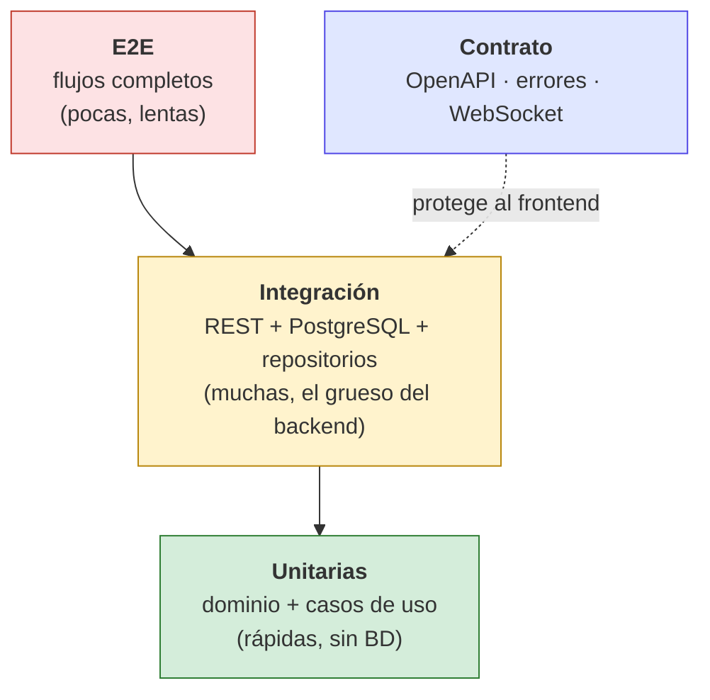
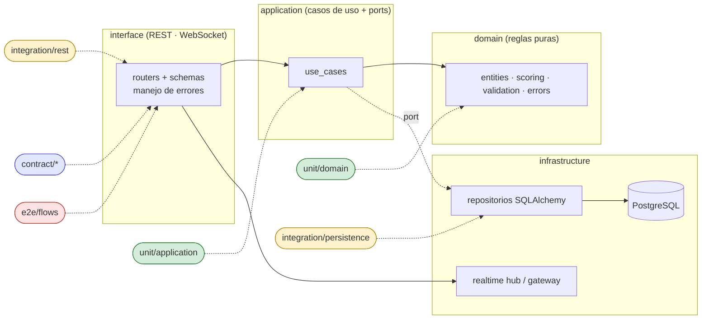
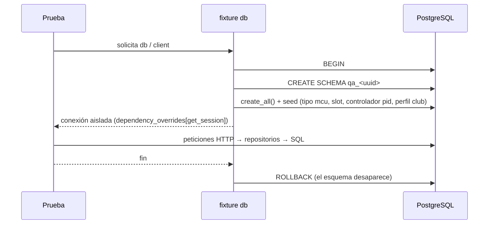

# Pruebas del backend — velocista-backend

Documentación de la estrategia, estructura y ejecución de las pruebas automáticas del backend
(FastAPI + SQLAlchemy + PostgreSQL). Todo el código, nombres de archivos y campos están en
**inglés**; solo los mensajes que ve el usuario final van en español (regla del profesor).

> Plan detallado y matriz de trazabilidad: [`PLAN_DE_PRUEBAS.md`](PLAN_DE_PRUEBAS.md)

## 1. Tipos de prueba

Las carpetas se organizan **por tipo de prueba** (no por historia de usuario), tal como lo pidió el profesor.

| Tipo | Carpeta | ¿Qué valida? | ¿Necesita BD? | Velocidad |
|------|---------|--------------|:-------------:|-----------|
| Unitaria | [`unit/`](unit/README.md) | Reglas de dominio y casos de uso aislados, con dobles en memoria | No | ms |
| Integración | [`integration/`](integration/README.md) | Repositorios SQL y endpoints REST reales contra PostgreSQL | **Sí** | segundos |
| Contrato | [`contract/`](contract/README.md) | Que la API (REST y WebSocket) mantenga la forma acordada con el frontend | Parcial | ms |
| Extremo a extremo | [`e2e/`](e2e/README.md) | Flujos completos del operador y del robot | **Sí** | segundos |
| Soporte | [`support/`](support/README.md) | Fixtures y *builders* compartidos (no contiene pruebas) | — | — |

## 2. Pirámide de pruebas



## 3. Qué capa de la arquitectura prueba cada tipo

El backend sigue *Clean Architecture*: las dependencias apuntan hacia el dominio.



## 4. Estructura de carpetas

```text
tests/
├── README.md                      ← este documento
├── PLAN_DE_PRUEBAS.md             ← plan + matriz de trazabilidad
├── conftest.py                    ← fixtures globales (InMemoryRunRepository)
├── support/
│   └── db_fixtures.py             ← db, client, build, service_headers
├── unit/
│   ├── domain/{config,events,optimization,runs,shared}/
│   └── application/{optimization,runs}/
├── integration/
│   ├── persistence/               ← repositorios contra PostgreSQL
│   └── rest/{auth,builder,catalog,config,devices,events,optimization,rules,runs,system}/
├── contract/
│   ├── rest/                      ← OpenAPI y formato de error
│   └── websocket/                 ← envelope, traducción, catálogo de mensajes
└── e2e/flows/                     ← recorridos completos
```

## 5. Cómo ejecutarlas

```powershell
# 1) Base de datos de pruebas (Docker Desktop encendido)
docker compose up -d

# 2) Variables mínimas (PowerShell)
$env:POSTGRES_PASSWORD = "<la del .env>"

# 3) Todo
pytest

# Solo lo rápido (no necesita BD)
pytest tests/unit tests/contract/websocket

# Por tipo
pytest tests/integration/rest
pytest tests/integration/persistence
pytest tests/contract
pytest tests/e2e

# Un contexto concreto
pytest tests/integration/rest/runs -k ingest -v
```

Con `pytest -rs` se ven las pruebas omitidas y su motivo.

## 6. Cómo funciona el aislamiento de la BD

Cada prueba de integración/E2E crea un **esquema temporal** dentro de una transacción y lo
deshace al terminar; así no ensucia la BD de desarrollo y pueden correr en cualquier orden.



## 7. Convenciones

- Archivos `test_*.py`; clases `Test<Cosa>`; métodos `test_<acción>_when_<condición>[_returns_<resultado>]`.
- Estructura *given / when / then* (comentarios opcionales cuando el caso es largo).
- Los dobles de prueba **implementan los ports** de `application`; no se simula SQLAlchemy.
- Los datos de prueba se crean por la **API pública** (`build.robot()`, `build.version()`, …), no insertando filas a mano, salvo el *seed* de referencia.
- Una prueba = una razón para fallar. Los casos con la misma lógica se agrupan con `@pytest.mark.parametrize`.
- Mensajes de error: se comprueba el `reason` (código estable), no el texto en español.
- Formato y lint: `ruff format` / `ruff check` (línea máx. 100).

## 8. Estado actual

| Tipo | Archivos nuevos | Casos nuevos |
|------|:---------------:|:------------:|
| Unitarias | 6 | 34 |
| Integración REST | 11 | 129 |
| Integración persistencia | 1 | 8 |
| Contrato | 3 | 43 |
| **Total** | **23** | **219** |
| E2E | 2 | 5 |

Resultado de la última corrida local: **todas las nuevas pasan**; la suite completa tiene
1 fallo preexistente (ver *Hallazgos* en el plan) y 13 pruebas omitidas (plantillas vacías del equipo).

## 9. Cómo agregar una prueba nueva

1. Elegir el tipo: ¿es una regla pura? → `unit`. ¿Toca BD o HTTP? → `integration/rest/<contexto>`. ¿Es un acuerdo con el frontend? → `contract`. ¿Es un recorrido de varios pasos? → `e2e/flows`.
2. Crear `test_<tema>_api.py` en la carpeta del contexto y usar los fixtures `client` y `build`.
3. Probar el camino feliz **y** al menos un error por cada regla (404, 409, 422).
4. Ejecutar `pytest <ruta> -v`, luego `ruff format` y `ruff check`.
5. Actualizar la matriz del plan de pruebas si se cubre una funcionalidad nueva.
