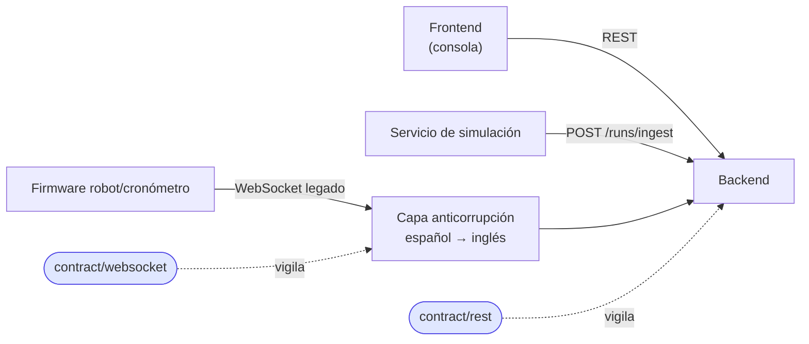

# Pruebas de contrato (backend)

El **contrato** es lo que el backend le promete al frontend, al simulador y al firmware:
rutas, nombres de campos, formato de errores y mensajes WebSocket. Estas pruebas fallan **antes**
de que un cambio rompa a otro equipo.



## Contenido

| Archivo | Garantiza |
|---------|-----------|
| `rest/test_openapi_contract.py` | los 42 endpoints acordados existen; todo cuelga de `/api`; `operationId` únicos en inglés; campos `snake_case`; páginas `items/total/limit/offset`; campos mínimos de `RobotOut`, `RunOut`, `RunIngestion` |
| `rest/test_error_format_contract.py` | errores de negocio como `{"detail":{"reason","detail"}}` con 404/409/422/403; el 500 no filtra detalles internos |
| `websocket/test_message_contract.py` | *envelope* (`type`, `seq`, `ts`, `sender`, `received_ms`) y sus rangos; traducción legado→inglés y viceversa; nombres de canal del firmware intactos; comandos declarados en el catálogo |
| `test_message_catalog.py` | plantilla previa del equipo (omitida) |

## Cuándo se actualiza una prueba de contrato

Solo cuando el equipo **acuerda** cambiar la API. El orden correcto es:

1. Acordar el cambio con frontend (y simulador si aplica).
2. Cambiar el backend **y** la prueba de contrato en el mismo commit.
3. Avisar en el PR para que el frontend ajuste su cliente.

```powershell
pytest tests/contract -q
```
