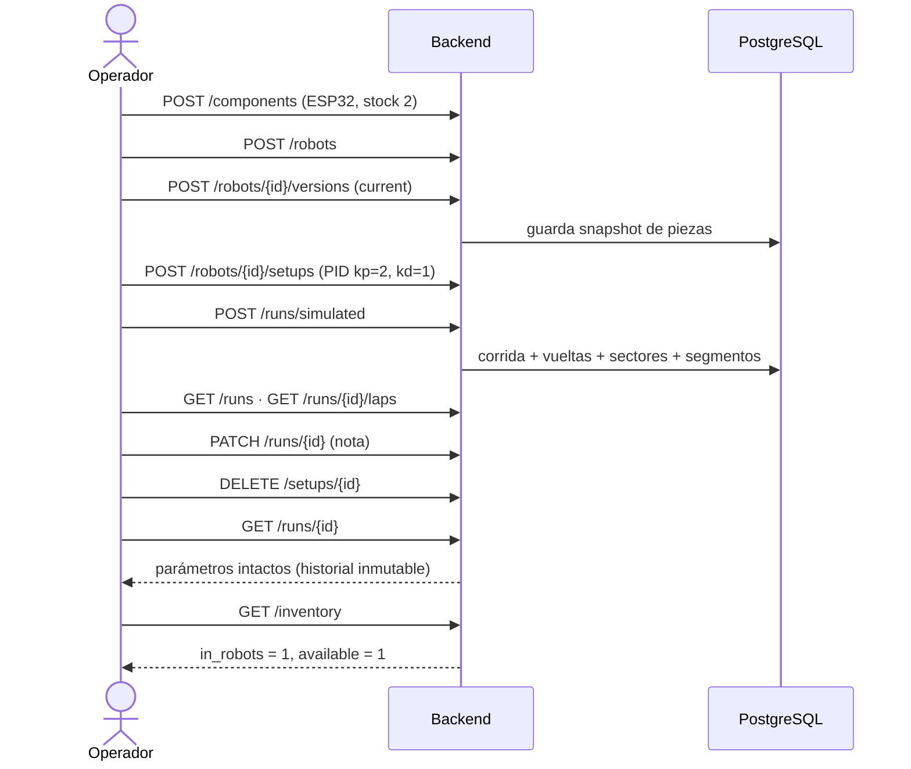
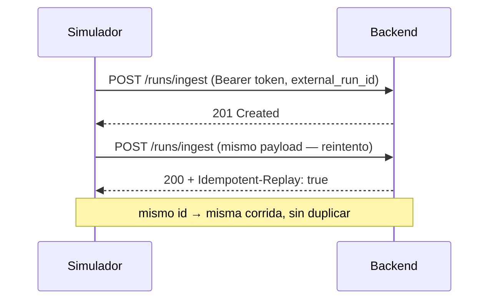
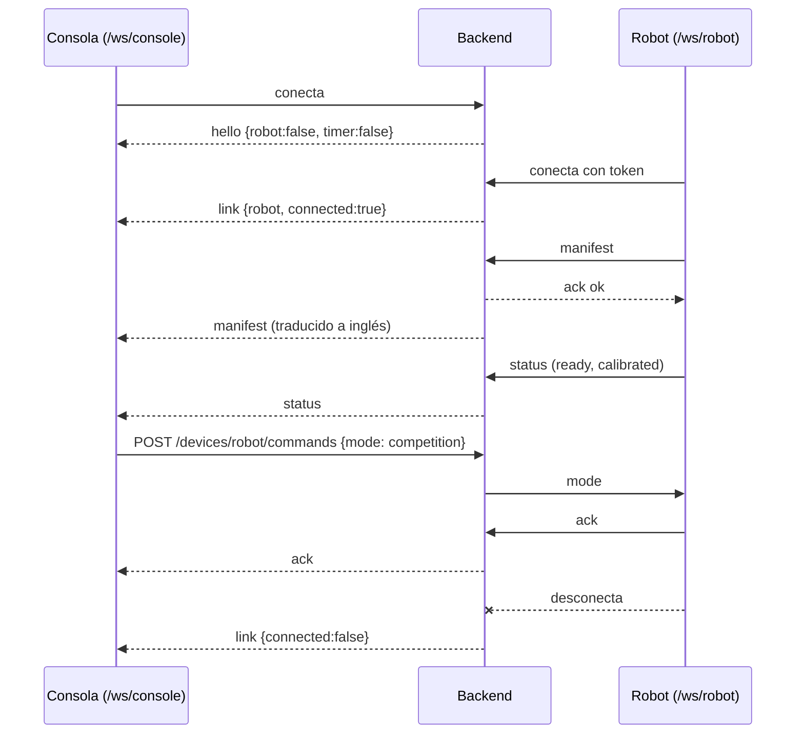

# Pruebas extremo a extremo (backend)

Recorren **un proceso completo** como lo haría el operador, el simulador o el robot, atravesando
todas las capas con PostgreSQL real.

## Flujo 1 — Recorrido del operador (`flows/test_operator_journey.py`)



## Flujo 2 — Servicio de simulación (`flows/test_operator_journey.py`)



## Flujo 3 — Sesión del robot por WebSocket (`flows/test_robot_websocket_flow.py`)



Casos extra: token inválido → cierre `1008`; `start` sin calibrar → `409 not_calibrated`.

## Ejecutar

```powershell
pytest tests/e2e -q
```

> `tests/e2e/test_ws_robot_flow.py` es una plantilla previa del equipo (omitida); los flujos reales están en `flows/`.
