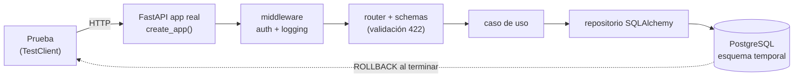
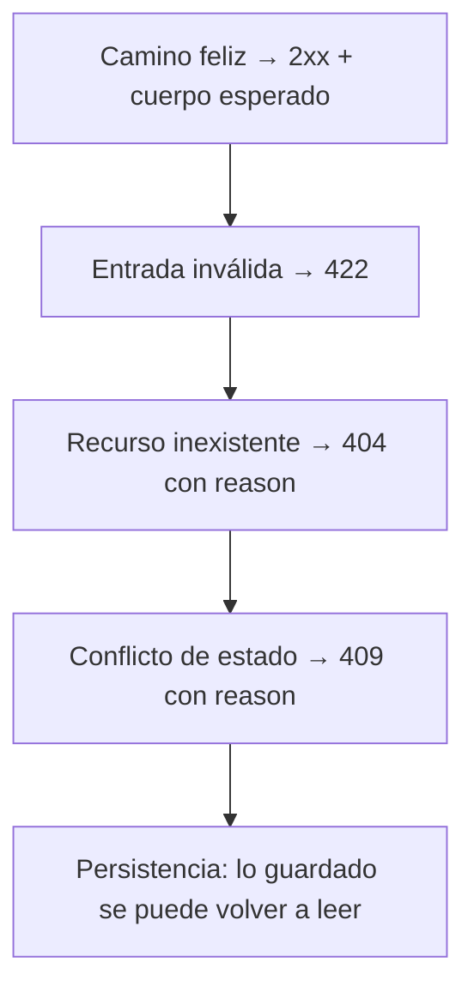

# Pruebas de integración (backend)

Comprueban que **las piezas funcionan juntas**: routers + casos de uso + repositorios + PostgreSQL real.
Son de **caja negra**: entran por HTTP y verifican respuesta, código de estado y estado persistido.



## Subcarpetas

| Carpeta | Foco | Fixtures |
|---------|------|----------|
| [`rest/`](rest/) | Cada endpoint `/api/*`, agrupado por contexto: `auth`, `builder`, `catalog`, `config`, `devices`, `events`, `optimization`, `rules`, `runs`, `system` | `client`, `build`, `service_headers` |
| [`persistence/`](persistence/) | Repositorios y restricciones de BD (únicos, claves foráneas, consultas) | `db` |

Archivos previos del equipo que siguen en esta carpeta (no se movieron): `test_authentication.py`,
`test_business_verticals.py`, `test_extended_rest.py`, `test_rest_postgres.py`.

## Qué se verifica en cada endpoint



## Ejemplo de prueba

```python
def test_ingest_when_same_payload_is_replayed_returns_200_same_run(client, build, service_headers):
    robot_id, version_id, setup_id = build.robot_ready()
    payload = build.ingestion_payload(robot_id, version_id, setup_id)

    first = client.post("/api/runs/ingest", json=payload, headers=service_headers)
    replay = client.post("/api/runs/ingest", json=payload, headers=service_headers)

    assert replay.status_code == 200
    assert replay.headers["idempotent-replay"] == "true"
    assert replay.json()["id"] == first.json()["id"]
```

## Requisitos para ejecutar

PostgreSQL arriba (`docker compose up -d`) y `POSTGRES_PASSWORD` definido. Sin BD, estas pruebas **fallan al inicio** (no se omiten en silencio).

```powershell
pytest tests/integration -q
pytest tests/integration/rest/runs -v
```
