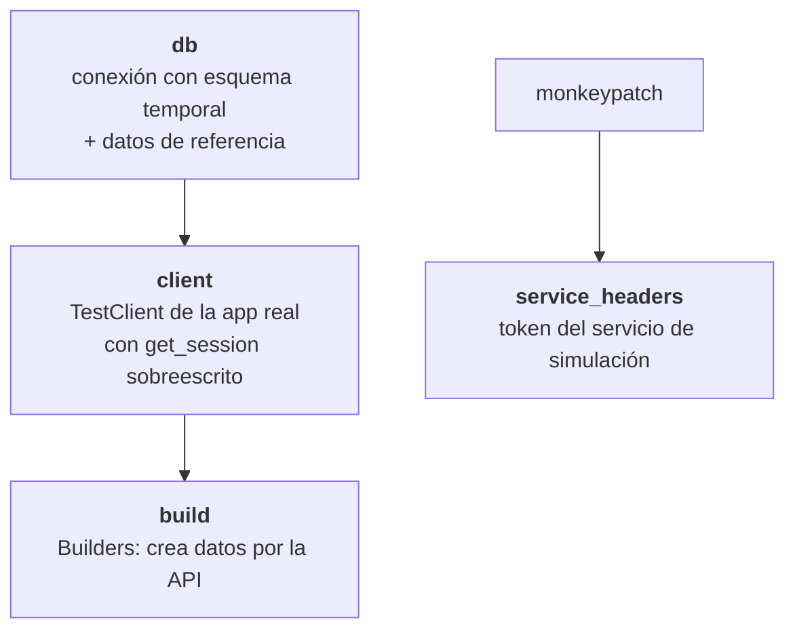

# Soporte de pruebas (backend)

Código compartido por las pruebas. **No contiene pruebas.**

## `db_fixtures.py`



| Fixture | Devuelve | Úsalo para |
|---------|----------|------------|
| `db` | conexión SQLAlchemy aislada | pruebas de repositorio |
| `client` | `TestClient` (no relanza excepciones del servidor) | llamar endpoints |
| `build` | `Builders` | preparar datos: `robot()`, `component()`, `version()`, `setup()`, `robot_ready()`, `ingestion_payload()` |
| `service_headers` | `{"Authorization": "Bearer …"}` | probar `/runs/ingest` |

### Datos de referencia sembrados por `db`

| Tabla | Registro |
|-------|----------|
| `component_type` | `mcu` |
| `slot` | `mcu` (obligatorio) |
| `controller` | `pid` con `kp∈[0,10]`, `kd∈[0,5]`, preset `Base` |
| `profile` | `club` |

### Cómo usarlo en una carpeta nueva

```python
# tests/integration/rest/<contexto>/conftest.py  (o en la carpeta padre)
from support.db_fixtures import Builders, build, client, db, service_headers  # noqa: F401
```
