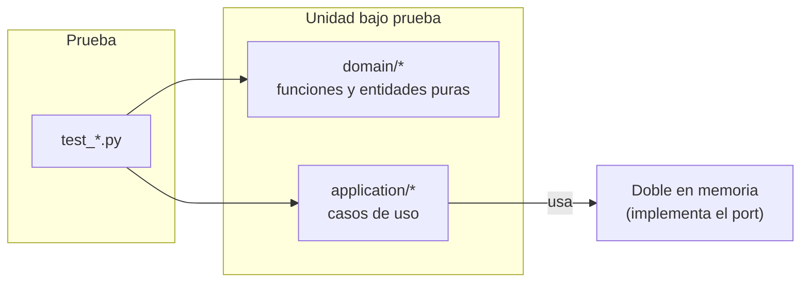

# Pruebas unitarias (backend)

Verifican **una sola unidad de lógica** sin base de datos, sin red y sin FastAPI. Son las más rápidas
(milisegundos) y las primeras en avisar de un error en una regla de negocio.



## Qué va aquí

| Carpeta | Se prueba | Ejemplos |
|---------|-----------|----------|
| `domain/optimization/` | `validate_parameters` | límites incluidos, fuera de rango, NaN/inf/bool, claves distintas |
| `domain/runs/` | métrica **J** y mejor vuelta *(existentes)* | `t + 2·error`, 120 si no terminó |
| `domain/shared/` | errores de dominio y su mapeo a HTTP | 404/409/422/403/503/400 |
| `domain/config/`, `domain/events/` | enumeraciones válidas en inglés | `test/competition`, `info/warning/error` |
| `application/optimization/` | `OptimizationService` con repositorio falso | versión ajena, controlador inexistente, archivar |
| `application/runs/` | cierre de vuelta *(plantilla del equipo)* | pendiente |

## Reglas

- **Prohibido** importar `sqlalchemy`, `fastapi` o abrir conexiones en esta carpeta.
- Los dobles implementan el *port* real (`application/*/ports.py`); no se parchea SQLAlchemy.
- Un caso por regla; usar `parametrize` para valores límite.

## Ejecutar

```powershell
pytest tests/unit -q
```
